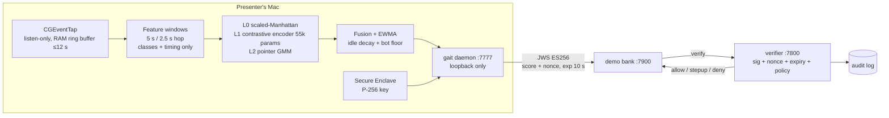

# GAIT — Behavioral Proof-of-Identity for macOS

A local daemon learns how one specific person types, moves, scrolls, and
clicks, keeps a rolling confidence score that it's still that person at the
keyboard, and hands out **short-lived, nonce-bound attestations signed by a
device-bound P-256 key** (Secure Enclave). Any server-side action can require
a fresh high-confidence attestation before proceeding.

Raw behavior never leaves RAM. The server only ever sees a signed number.

> Think "WebAuthn, except the authenticator keeps checking it's still you."

## Four attacks, one demo

| # | Attack | What happens |
|---|---|---|
| T1 | Second human takes over the unlocked Mac | Score falls below 0.4 in seconds → deny + failed step-up |
| T2 | Automation bot (pyautogui) drives the UI | Robotic-timing hard floor → score 0.02 → deny |
| T3 | Stolen session cookie from another machine | No attestation → HTTP 401 |
| T4 | Replayed attestation | Nonce single-use + 10 s expiry → deny |

## Architecture



## Quick start

```bash
make setup          # venv + deps + swift signer + CMU dataset + signer smoke test
make test           # full suite (features, privacy, CMU EER, JWS, policy, e2e)
scripts/run_all.sh  # verifier :7800 + bank :7900 + daemon :7777
```

First run: grant **Input Monitoring** and **Accessibility** to the Python
binary the daemon prints, then restart it.

Enroll (presenter, then both teammates as impostors):

```bash
make enroll                  # web UI at http://127.0.0.1:7777/enroll
# or: make enroll-cli PROFILE=user
```

Finishing a `user` enrollment auto-trains (<90 s), calibrates thresholds, and
registers the device key with the verifier. Results land in
`data/models/eval.md`.

- Dashboard: http://127.0.0.1:7777
- Bank: http://127.0.0.1:7900
- Demo: `demo/SCRIPT.md`, `demo/bot.py`, `demo/hijack.sh`

## Privacy invariants (enforced by tests)

- Raw events live in a RAM ring buffer capped at 12 seconds; `gait/capture/`
  has no file handles (`tests/test_privacy.py`).
- Persisted feature records contain **no key identities** — only 11 coarse key
  classes (left/right-hand letter, digit, space, punct, …) plus timing.
- Enrollment text, form contents, memo text: never stored anywhere.

## Out of scope (by design)

- Malware with root on the same Mac can lie to the verifier — same trust
  boundary as Touch ID on a compromised host. The Secure Enclave protects the
  *key*, not the daemon's integrity.
- Trained human mimicry / GAN-synthesized keystroke streams.

## Layout

- `gait/capture` — CGEventTap (listen-only) + RAM ring buffer
- `gait/features` — keystroke/pointer windowed features (the only thing persisted)
- `gait/model` — baselines, encoder, GMM, fusion, train/calibrate/eval
- `gait/attest` — compact JWS ES256; Secure Enclave CLI wrapper + software fallback
- `gait/daemon` — scoring daemon :7777 (loopback), enrollment, step-up
- `gait/verify` — verifier :7800 (nonce, signature, replay, policy, audit)
- `bank/` — demo bank :7900 (mock ledger; Nessie behind `USE_NESSIE=1`)
- `web/` — dashboard+enroll and bank UIs (Vite + React)
- `swift/gait-sign` — Secure Enclave P-256 keygen/sign CLI
