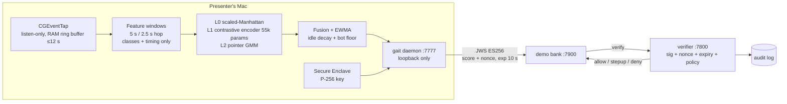

# Cadence — Proof of Human for AI Money Agents

AI agents can move your money. Today their authority is a **static bearer
credential** — an API key that says nothing about whether a real, specific,
authorized human is actually behind an action. Cadence is the missing
primitive: it binds an agent's authority to **live, revocable proof of a real
human**, and freezes the money the instant that proof breaks.

Three pieces make that proof:

1. **Identity Trust Graph** — a live graph of 12 evidence nodes across four
   tiers: *Identity* (CRS · TransUnion bureau match, credit file, Fraud
   Finder), *Device* (Secure Enclave key, network, location), *Presence*
   (keystroke/pointer dynamics + session continuity from an on-device model),
   and *Money* (Capital One Nessie recipient/amount/velocity history). Edges
   carry corroboration; every action requires a specific subgraph to be lit.
2. **A real Claude agent** that reasons over the graph in the open before a
   dollar moves — allow / step-up / deny, with the exact missing evidence —
   and executes approved transfers on Capital One (Nessie) rails.
3. **A scoped mandate** rooted in the human: granted while identity + presence
   are proven, auto-revoked the moment the person at the keyboard changes. A
   hijacked session, injected prompt, or synthetic identity moves nothing.

Raw behavior never leaves RAM. The server only ever sees a signed number
(**nonce-bound JWS ES256**, device-bound P-256 key in the Secure Enclave).

> Think "WebAuthn, except the authenticator keeps checking it's still you —
> and your AI agent's power of attorney dies the moment it isn't."

## Five attacks, one demo

| # | Attack | What happens |
|---|---|---|
| T1 | Second human takes over the unlocked Mac | Presence nodes contradict → mandate auto-revokes → agent freezes money |
| T2 | Prompt injection / out-of-mandate instruction to the agent | Graph coverage fails (new payee, high amount) → step-up only a live human can pass |
| T3 | Synthetic identity enrolls an agent | CRS Fraud Finder contradicts → denied live against TransUnion |
| T4 | Automation bot (pyautogui) drives the UI | Robotic-timing hard floor → score 0.02 → deny |
| T5 | Stolen session cookie / replayed attestation | No fresh nonce-bound attestation → HTTP 401 / deny |

## Architecture



## Pretrained on 136M keystrokes

The encoder is pretrained TypeNet-style (SupCon) on the
[Aalto 136M keystrokes dataset](https://userinterfaces.aalto.fi/136Mkeystrokes/)
— thousands of real typists — so it learns *what distinguishes typists in
general* before ever seeing the enrolled user. Enrollment then just locates one
person in that space. `make pretrain` (checkpoints by verification EER on
held-out users it never trained on); `make train` automatically picks the best
of {scratch, pretrained-frozen, pretrained-finetuned} on *your* data. The
pointer model can pull population negatives from the
[Balabit mouse dynamics dataset](https://github.com/balabit/Mouse-Dynamics-Challenge).

## Sponsor integrations (all live, all sandboxed)

Cadence fuses **four signals** into one trust decision. Behavior (above) is the
first; the other three run on sponsor APIs, and the trust score is only as good
as the regulated data underneath it — these are load-bearing, not bolt-ons.

**CRS — Financial Intelligence (StitchCredit sandbox, `api-sandbox.stitchcredit.com`)**
Powers the **Identity** signal and the high-value step-up rung:
- **TruValidate IDV** (`/transunion/identity-manager-verification/basic`) — identity
  verification at onboarding and before high-value payments.
- **Credit report, TU prequal FICO 9** (`/transunion/credit-report/standard/tu-prequal-fico9`)
  — pulled live to risk-tier the account.
- **Fraud Finder** (`/fraud-finder/fraud-finder`) — synthetic-identity scoring.

The demo's climax is TransUnion **rejecting a synthetic identity live**. We send
**only CRS's provided test personas** — P01 *Margaret Okafor* (pass, FICO 790,
fraud 11) and P13 *Kayla Brennan* (synthetic, FICO 640, fraud 88) — never a real
identity. Creds live in `.env` (gitignored). Note: the sandbox account latches
after a failed login, so authenticate cleanly.

**Capital One — Nessie (`api.nessieisreal.com`)**
Powers the real bank underneath Meridian and the **Transaction-anomaly** signal:
- Real customer + checking/savings accounts created via the API.
- Every payment is a real Nessie **transfer**; balances are derived from the
  transfer ledger, never faked client-side.
- That transaction history feeds the fourth signal (amount/recipient/velocity
  anomaly) that the fusion engine weighs alongside behavior and identity.

Live status for all four (plus Secure Enclave) is visible in the Console's
**Integrations** view at `:7800/#/integrations`.

## Beyond the bank: Cadence as an authorization rail

- `scripts/gait-exec -- <command>` — any shell command gated by a fresh
  attestation (`gait-exec --action deploy -- ./deploy.sh`)
- `python -m gait.daemon.app --guard` — active response: locks the Mac after
  6 s of confident "this is not the enrolled user" input
- The same `/verify` endpoint can front any API: payments, deploys, agent
  actions — anything that should require a *human you* at the keyboard.

## Quick start

```bash
make setup          # venv + deps + swift signer + CMU dataset + signer smoke test
make test           # full suite (features, privacy, CMU EER, JWS, policy, e2e)
scripts/run_all.sh  # verifier :7800 + bank :7900 + daemon :7777
```

First run: grant **Input Monitoring** and **Accessibility** to the Python
binary the daemon prints, then restart it.

Enroll (presenter, then both teammates as impostors):

```bash
make enroll                  # web UI at http://127.0.0.1:7777/enroll
# or: make enroll-cli PROFILE=user
```

Finishing a `user` enrollment auto-trains (<90 s), calibrates thresholds, and
registers the device key with the verifier. Results land in
`data/models/eval.md`.

- Dashboard: http://127.0.0.1:7777
- Bank: http://127.0.0.1:7900
- Demo: `demo/SCRIPT.md`, `demo/bot.py`, `demo/hijack.sh`

## Privacy invariants (enforced by tests)

- Raw events live in a RAM ring buffer capped at 12 seconds; `gait/capture/`
  has no file handles (`tests/test_privacy.py`).
- Persisted feature records contain **no key identities** — only 11 coarse key
  classes (left/right-hand letter, digit, space, punct, …) plus timing.
- Enrollment text, form contents, memo text: never stored anywhere.

## Out of scope (by design)

- Malware with root on the same Mac can lie to the verifier — same trust
  boundary as Touch ID on a compromised host. The Secure Enclave protects the
  *key*, not the daemon's integrity.
- Trained human mimicry / GAN-synthesized keystroke streams.

## Layout

- `gait/capture` — CGEventTap (listen-only) + RAM ring buffer
- `gait/features` — keystroke/pointer windowed features (the only thing persisted)
- `gait/model` — baselines, encoder, GMM, fusion, train/calibrate/eval
- `gait/attest` — compact JWS ES256; Secure Enclave CLI wrapper + software fallback
- `gait/daemon` — scoring daemon :7777 (loopback), enrollment, step-up
- `gait/verify` — verifier :7800 (nonce, signature, replay, policy, audit)
- `bank/` — Meridian bank :7900 (real Capital One Nessie transfers + ledger)
- `gait/verify/crs.py` — CRS TruValidate IDV, credit report, Fraud Finder (test personas only)
- `web/` — dashboard+enroll and bank UIs (Vite + React)
- `swift/gait-sign` — Secure Enclave P-256 keygen/sign CLI
